<div align="center">

# 湖科电量

湖北科技学院宿舍电量查询的 iOS 与 Android 客户端。

简体中文 · [English](README.md)

[](#开始使用)
[](#开始使用)
[](#测试)

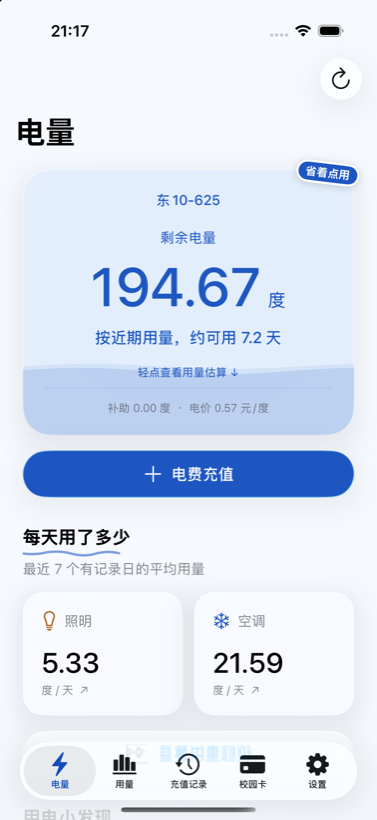
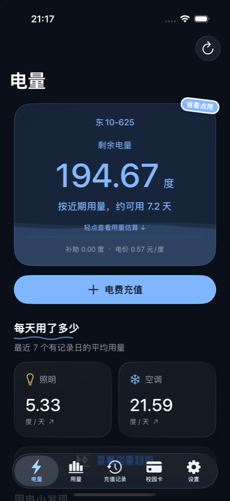
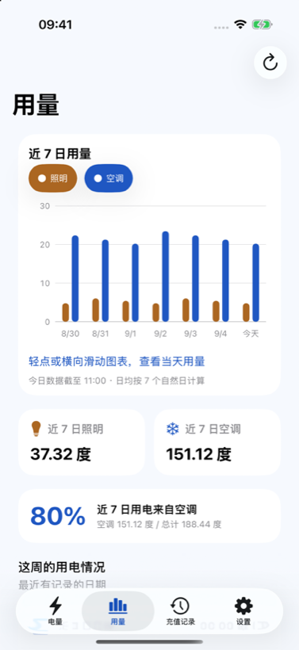

</div>

## 为什么做这个

在智慧湖科里看宿舍还剩多少电，要点好几层。这个应用把最常看的两个数放在第一屏：还剩多少度，大概还能用几天。

电量、用量和充值记录都直接从学校的网页读取，密码不会保存。

## 功能

| | |
|---|---|
| 电量 | 剩余度数、预计可用天数、补助和电价 |
| 用量 | 近 7 天照明和空调的柱状图，点一下或横着拖可以看某一天 |
| 充值记录 | 带汇总卡的历史记录，点进去能看一条记录的全部字段 |
| 校园卡 | 通过官方一卡通门户读取余额，有多张卡时显示合计 |
| 低电量提醒 | 电量第一次低于设定值时发一条本地通知 |
| 更新与公告 | 有新版本时提示；学校系统维护之类的消息会显示在首页 |
| 调试与诊断 | 通知和会话状态、刷新耗时，还有一份可以复制的脱敏报告 |

还有一些小设计：

- 余额卡像个水箱，剩得越多水位越高。倾斜手机，液面跟着晃；横着拨一下，水跟着手指走。读到新的电量时，数字从旧值数上去。
- 下拉要拉到位再松手才刷新。圆环转起来、冒火花，成功了变绿打勾，失败了变橙摇头。
- 用电小发现是一排能左右滑的小卡片，比如这周比上周省了 12%、连续 3 天低于平均、空调占了 81%、剩余电量约值 ¥57、上次充值是 12 天前。
- 充值计算器正着反着都能算：选金额，看能用到哪天；选日期，看至少要充多少。可以按宿舍人数分摊，复制一句话直接发群里。
- 手绘下划线、有点歪的贴纸、关于页上用胶带贴着的便签，还有一个彩蛋。

### 主题

**设置 → 外观** 里有三套配色，其中两套以朋友命名。

| 主题 | 配色 | 额外的小东西 |
|---|---|---|
| 湖科蓝 | 云白配清蓝 | 应用原本的样子 |
| 紫鸟紫 | 夜色紫配琥珀橙 | 每次打开显示一句《飞鸟集》 |
| 枫烻黄 | 暖黄配项圈红 | 点一下会摇的铃铛 |

换主题时，卡片、图表、水位、火花和小组件会一起换色。

<div align="center">
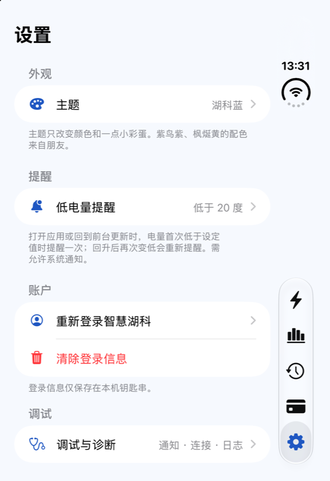
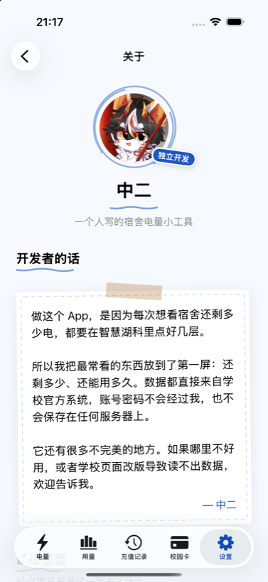
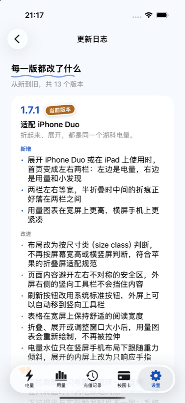
</div>

### 小组件

桌面有小号和中号，锁屏有三种样式。颜色跟着当前主题走，电量偏低时换成提醒色。

<div align="center">
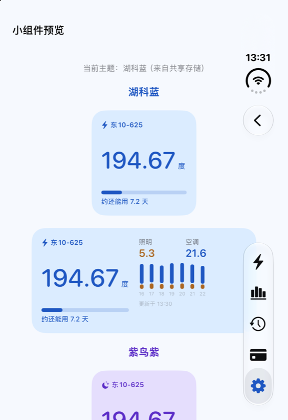
</div>

> 小组件通过 App Group（`group.com.local.hbustpower`）读取应用的数据，而 App Group 要付费开发者账号才能用。用免费 Apple ID 侧载时，扩展能装上，但拿不到共享存储，小组件会一直显示“打开一次湖科电量”。共享存储有没有生效，可以在 **设置 → 调试与诊断 → 小组件** 里看到。

### 折叠屏与大屏

布局按尺寸类判断，不看屏幕宽高，也不看横竖屏。

- 展开的内屏和 iPad 上是左右等宽两栏，外屏和普通手机上是一栏。
- 半折叠时，两栏之间的空隙对准 `reservedRegions(kind: .division)`（iOS 27.1+）给出的折痕位置，按钮不会落在折痕上。用 Xcode 27.0 编译的版本没有这一步，保持等宽两栏。
- 内容避开左右不对称的安全区，外屏右侧的竖向工具栏不会挡住东西。
- 在 iPhone Duo 模拟器上试过四种形态：外屏、内屏横向、内屏竖向、半折叠。

<div align="center">
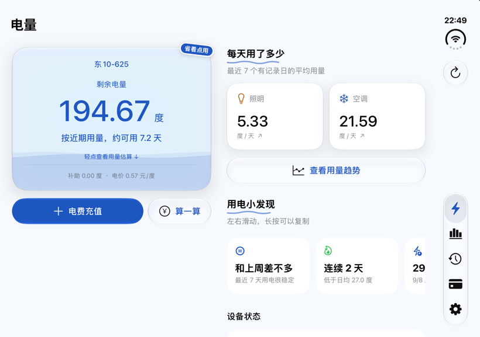
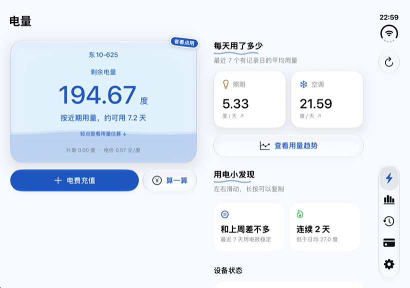
</div>

<details>
<summary>更多界面</summary>

<div align="center">
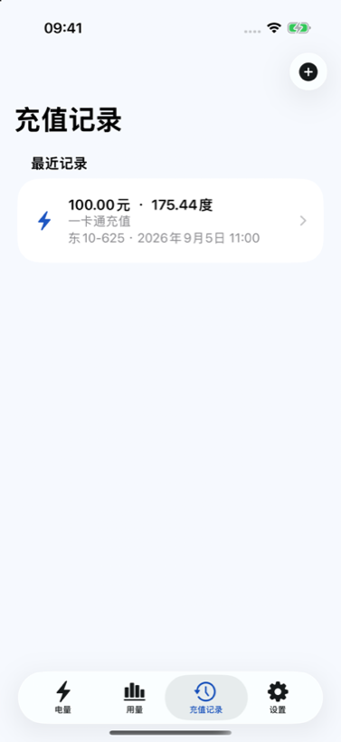
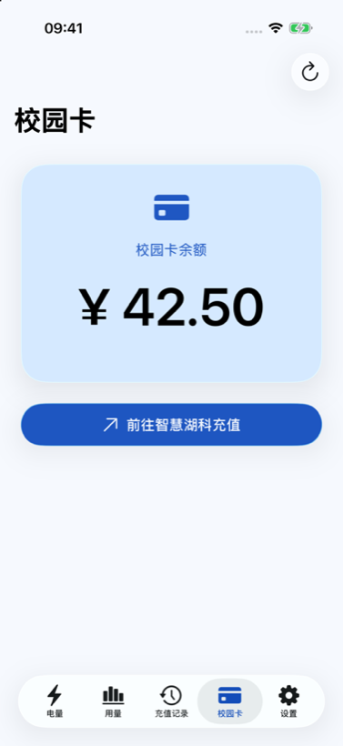
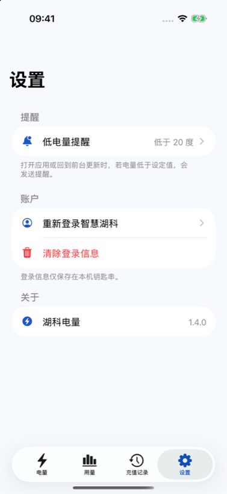
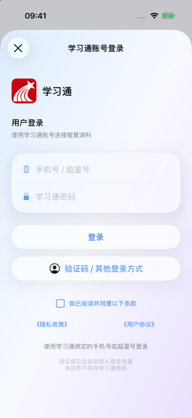
</div>

</details>

## 隐私

- 登录在学习通自己的页面上完成。应用把你输入的内容填进官方表单，不保存密码。
- 只保存授权链接：iOS 放在钥匙串里，Android 用 Android Keystore 加密。
- 电量、用量、充值记录和校园卡数据只在你的手机和学校之间传输，不经过开发者。
- 另外，应用会到开发者的站点检查新版本和公告，并且每天最多发送一次匿名使用统计。统计默认开启，可以在首次启动引导页或 **设置 → 帮助改进** 里关掉。具体发送哪些内容见隐私政策。
- 诊断信息不含账号、宿舍号、授权链接和 Cookie 内容。
- 授权跳转链接严格校验：主机和路径完全一致，`appId=180` 和 token 各出现一次，token 不能为空。

完整的隐私政策见 [filing/03-隐私政策.md](filing/03-隐私政策.md)。

## 开始使用

### iOS 环境要求

- Xcode 26 或更高（iPhone Duo 模拟器和折痕对齐需要 27.1+）
- iOS 26 或更高
- 想让小组件显示真实数据，需要付费开发者账号

### iOS 编译运行

```sh
git clone https://github.com/zebwqfox/hbustpower.git
cd hbustpower/ios
open HBUSTPowerIOS.xcodeproj
```

在 Signing & Capabilities 里选自己的 Team，选好设备运行。

### Android 编译运行

需要 Android SDK Platform 37、Build Tools 36+ 和 JDK 17–26。应用最低支持 Android 6。

```powershell
cd android
.\gradlew.bat testDebugUnitTest assembleDebug lintDebug
```

调试安装包在 `android/app/build/outputs/apk/debug/app-debug.apk`，其他说明见 [Android 开发文档](android/README.md)。

### 在两台电脑之间同步密钥

学校的 app key 不进仓库。明文放在本地的 `secrets/secrets.env`，这个文件不进 git；加密后的 `secrets/secrets.env.enc` 提交到仓库，所以 Mac 和 Windows 上 `git pull` 一下就同步了。只有口令不在 git 里，记在密码管理器里就行。

```sh
./scripts/secrets.sh unlock   # secrets.env.enc -> secrets.env（会问口令）
./scripts/secrets.sh apply    # 生成 ios/Config/Secrets.xcconfig 和 android/secrets.properties
./scripts/secrets.sh lock     # secrets.env -> secrets.env.enc，然后提交
```

Windows 上用 `scripts\secrets.ps1`，命令一样。两个脚本只依赖 `openssl`，macOS 自带，装了 Git for Windows 也有。

没有密钥文件时两边照样能编译：iOS 用 `ios/Config/Base.xcconfig` 里的占位值，Android 的 `BuildConfig.SCHOOL_APP_KEY` 为空，应用会提示还没配置。

### 配置学校入口

把 `secrets/secrets.env.example` 复制成 `secrets/secrets.env`，填上学校当前的 `appKey`，再执行 `./scripts/secrets.sh apply`。这个值从学校官方入口取得。其余参数（`fidEnc`、`mappId`、`wfwEnc`）写在源码里，是本校的配置，换个学校用不了。

### 打未签名 IPA

```sh
cd ios
./build_sideloadly_ipa.sh        # 生成 dist/湖科电量-iOS26-Sideloadly.ipa
```

把 IPA 拖进 [Sideloadly](https://sideloadly.io)，用自己的 Apple ID 重新签名安装。**不要勾选 Use automatic bundle ID**：它会改掉应用的包标识符，而小组件扩展的标识符必须以应用的为前缀，否则 iOS 不认这个扩展。

### 调试启动参数

iOS 调试版支持下面这些参数，离线看界面时用得上。

| 参数 | 作用 |
|---|---|
| `--ui-preview` | 使用离线演示数据，不联网 |
| `--preview-tab=1…4` | 直接打开用量 / 充值记录 / 校园卡 / 设置 |
| `--preview-about`、`--preview-changelog`、`--preview-widgets` | 直接打开对应页面 |
| `--slow-refresh-preview` | 演示刷新延迟 3 秒，方便看充电动画 |
| `--liquid-gravity-x=-0.5` | 模拟重力，检查水位倾斜方向 |
| `--simulate-vertical-bar` | 模拟不对称安全区，类似 Duo 外屏 |

## 工程结构

```
ios/
├─ HBUSTPowerIOS/
│  ├─ Models/           应用状态、数据模型、小发现、充值计算、更新日志
│  ├─ Services/         网络、HTML 解析、钥匙串、通知、诊断
│  ├─ ViewControllers/  电量、用量、记录、校园卡、设置、关于、计算器
│  └─ Views/            主题、动效、图表、水位、贴纸、下拉充电
├─ HBUSTPowerWidgets/   小组件扩展
├─ Shared/              应用与小组件共用的代码
├─ HBUSTPowerIOSTests/  单元测试
└─ WidgetSupport/       小组件的 Info.plist 与权限文件
android/                 Kotlin + Jetpack Compose Android 客户端
fixtures/                两个平台共用的脱敏 HTML 测试样本
filing/                  隐私政策、用户协议与备案材料
```

数据怎么来的：WebView 完成官方登录，应用截下电费授权跳转，把学校的 Cookie 同步到自己的 HTTP 会话，再请求三个页面解析出数据。解析放在 `ElectricityHTMLParser` 里，不碰网络，所以能直接拿样本测。

## 测试

```sh
cd ios
xcodebuild test -project HBUSTPowerIOS.xcodeproj -scheme '湖科电量' \
  -destination 'platform=iOS Simulator,name=iPhone 17'
```

iOS 有 64 个 XCTest 测试方法；Android 有 85 项 JVM 单元测试，并通过 Android Lint。测试集中在最容易出问题的地方：HTML 解析、授权跳转校验、用量估算、充值计算、远程配置和更新日志。

## 计划

- [x] iOS 应用
- [x] 主题、小组件、充值计算器
- [x] iPhone Duo 适配
- [x] Android 客户端（Kotlin + Jetpack Compose），在 `android/` 下
- [ ] 用付费账号签名后在真机上验证小组件

## 致谢

- 作者和维护者：[@zebwqfox](https://github.com/zebwqfox)
- 登录走学习通和学校的官方服务，学习通 Logo 只用来标明登录方式。
- 紫鸟紫、枫烻黄两套配色以两位朋友命名。
- 《飞鸟集》诗句取自泰戈尔 1916 年原作和郑振铎 1922 年的译本，都已过版权保护期。
